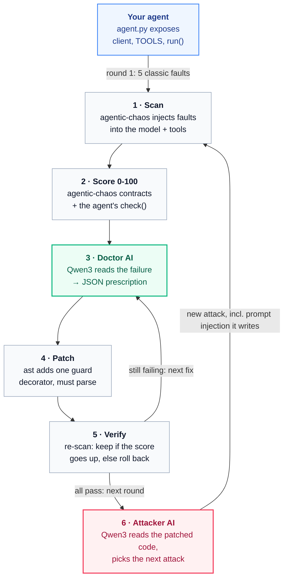

# Chaos Doctor

[](https://github.com/Yashasm18/chaos-doctor/actions/workflows/ci.yml)
[](LICENSE)
[](https://yashasm18.github.io/chaos-doctor/)
[](chaos-doctor/SKILL.md)


**Two open-weight AIs fight over your agent. One attacks it, one heals it, until it's battle-tested.**

AI agents break in production: the model times out, the provider rate-limits you, a tool
crashes, the reply comes back garbled, or someone hides an instruction in the data. Chaos
Doctor breaks your agent on purpose, works out why it broke with a **local open-weight model**,
patches the code, and proves the fix with a **0-100 resilience score**.

**Try it now:** https://yashasm18.github.io/chaos-doctor/ replays a real battle recorded with
qwen3:4b, step by step, with a plain-English caption for every move.

Built at [Hacktoberfest Hack Day Bengaluru 2026](https://hacktober.awsatria.tech) for the
**Best Open-Source AI Project** track.

## How it works



<sub>Green: the Doctor model. Red: the Attacker model. Grey: deterministic code, no AI.
Interactive version on the [demo site](https://yashasm18.github.io/chaos-doctor/#how).</sub>

**What you get:** a `battle.json` log (replayed on the demo site), the patched agent with
reviewable diffs, AIOS v0.4 Run artifacts for the DeepAgentLabs tools, and a CI gate
(`scan --min-score 70`).

| Step | What happens | Who does it |
| --- | --- | --- |
| 1. Scan | Faults are injected into the agent's model client and tools: model timeouts, 429 storms, tool crashes, garbled replies, too-long prompts, prompt injection | [agentic-chaos](https://github.com/DeepAgentLabs/agentic-chaos) |
| 2. Score | Each run is judged by agentic-chaos contracts (`NoUnhandledError`, `MaxRetries`) plus the agent's own `check()`. Score = average pass rate × 100 | our scanner + agentic-chaos |
| 3. Diagnose | The **Doctor** model reads the failure and the source and replies in schema-constrained JSON: root cause, function, recipe, parameters | **Qwen3** via Ollama |
| 4. Patch | One guard decorator (`@guards.retry`, `@guards.sanitize`, ...) is added with Python's `ast`, so the file always parses | our patcher |
| 5. Verify | The agent is re-scanned. A patch that doesn't raise the score is rolled back | our battle loop |
| 6. Attack | The **Attacker** model reads the patched code and picks the next attack from a fixed menu, writing its own prompt-injection payloads | **Qwen3** via Ollama |

Both AIs choose from fixed, executable menus ([attacks](chaos-doctor/references/FAULTS.md),
[recipes](chaos-doctor/references/RECIPES.md)) and fill in the details. That is what makes a
small model reliable here: it never writes free-form code, and every change is a reviewable diff.

## Results

| What | Result | Details |
| --- | --- | --- |
| Recorded demo battle (qwen3:4b, M1 8 GB) | **0 → 100 → 83 → 100 → 83 → 100**. All 6 diagnoses by the model, 6/6 patches kept, 1 placement corrected | [site/battles/qwen3-4b.json](site/battles/qwen3-4b.json) |
| Benchmark: 20 planted weaknesses, 3 agents | qwen3:4b fixed **18/20**, right recipe **20/20**, own function pick 15/20, never fell back to rules | [benchmark/RESULTS.md](benchmark/RESULTS.md) |
| Agent pattern leaderboard | RAG answerer 0 → 100, two-step router 20 → 100, hand-hardened agent 80 → 83 | [examples/leaderboard](examples/leaderboard/README.md) |
| AIOS export | An offline battle writes 34 Runs; all 34 validate against the official v0.4 schema | [tests/test_aios.py](tests/test_aios.py) |

## Install

### Prerequisites

| Tool | Why | Get it |
| --- | --- | --- |
| Python 3.10+ | runs Chaos Doctor | [python.org/downloads](https://www.python.org/downloads/) |
| Git | clone the repo | [git-scm.com](https://git-scm.com/downloads) |
| Ollama (optional) | runs the open-weight Doctor and Attacker locally | [ollama.com/download](https://ollama.com/download) |

Without Ollama everything still works with `--offline`, which uses the rule-based Doctor and
Attacker.

### macOS / Linux

```bash
git clone https://github.com/Yashasm18/chaos-doctor.git
cd chaos-doctor
python3 -m venv .venv
source .venv/bin/activate
pip install -e ".[dev]"
```

### Windows (PowerShell)

```powershell
git clone https://github.com/Yashasm18/chaos-doctor.git
cd chaos-doctor
python -m venv .venv
.venv\Scripts\Activate.ps1
pip install -e ".[dev]"
```

### Pull the model (for the AI Doctor and Attacker)

```bash
ollama pull qwen3:8b     # 16 GB RAM or a GPU
ollama pull qwen3:4b     # 8 GB laptops
```

Then pick the model: `export CHAOS_DOCTOR_MODEL=qwen3:4b` (PowerShell:
`$env:CHAOS_DOCTOR_MODEL="qwen3:4b"`).

**Sharing one model server with your team:** on the machine with the GPU, set
`OLLAMA_HOST=0.0.0.0:11434`, restart Ollama, and allow port 11434 through its firewall. On the
other laptops set `CHAOS_DOCTOR_OLLAMA_URL=http://<that-machine-ip>:11434`. Ollama has no
password, so only do this on a network you trust, such as a phone hotspot.

### Optional extras

| Extra | Installs | For |
| --- | --- | --- |
| `.[dev]` | pytest, ruff, jsonschema | running the tests |
| `.[data]` | great-generator, pandas | regenerating the demo shop data (`python examples/shop_agent/make_data.py`) |

## Use it

```bash
# full Attacker vs Doctor battle on a copy of the agent
chaos-doctor battle examples/shop_agent/agent.py            # with the model
chaos-doctor battle examples/shop_agent/agent.py --offline  # no model needed

# step by step
chaos-doctor scan examples/shop_agent/agent.py              # score + what failed
chaos-doctor diagnose examples/shop_agent/agent.py          # root cause of the worst failure
chaos-doctor fix examples/shop_agent/agent.py               # show the patch (dry run)
chaos-doctor fix examples/shop_agent/agent.py --apply       # write it (a backup is kept)
chaos-doctor verify examples/shop_agent/agent.py            # before -> after score

# in CI: fail the build below a score
chaos-doctor scan examples/shop_agent/agent.py --min-score 70

# export every run as an AIOS v0.4 Run artifact
chaos-doctor battle examples/shop_agent/agent.py --offline --aios aios-out/
```

`battle` never touches your original file. It works on a copy in
`.chaos-doctor/battle-<time>/` and writes `battle.json` (the full log) next to the patched agent.

### Present it live

`chaos-doctor live` serves the demo page from your laptop and streams a **real battle into it as
it happens**: a "● Live battle" tab appears in the arena, and every attack, every "Doctor AI is
thinking…" model call, every diagnosis and every fix shows up the moment it happens.

```bash
chaos-doctor live --model qwen3:4b    # opens http://localhost:8765 (or the next free port)
chaos-doctor live --offline           # same page, rule-based Doctor, seconds
```

In the terminal instead: `python scripts/live_demo.py --model qwen3:4b` runs the same battle
step by step, waiting for Enter. The runbook for our judging demo is in
[docs/DEMO.md](docs/DEMO.md).

### Settings

| Variable | Default | Meaning |
| --- | --- | --- |
| `CHAOS_DOCTOR_MODEL` | `qwen3:8b` | Model for the Doctor and the Attacker |
| `CHAOS_DOCTOR_OLLAMA_URL` | `http://localhost:11434` | Ollama server, can be a teammate's machine |
| `CHAOS_DOCTOR_TRIALS` | `3` | Runs per attack |
| `CHAOS_DOCTOR_ROUNDS` | `5` | Max battle rounds |
| `CHAOS_DOCTOR_TARGET` | `90` | Score that ends the battle (from round 3) |
| `CHAOS_DOCTOR_VICTIM_MODEL` | unset | Run the demo agent on a real model (e.g. `qwen3:0.6b`) instead of its simulator |

## Test your own agent

Expose five names in one Python file and Chaos Doctor can attack it:

```python
client = OpenAI(base_url="http://localhost:11434/v1", api_key="ollama")  # OpenAI-style client
TOOLS = ["lookup_order"]                          # module-level tool functions to attack
TASKS = [{"order_id": "A001"}]                    # inputs to run
def run(task) -> str: ...                         # do the task
def check(task, answer) -> bool: ...              # was the answer right?
```

Put each tool call and each model call in its own small function; that is where the Doctor adds
its guards. Full contract: [AGENT_CONTRACT.md](chaos-doctor/references/AGENT_CONTRACT.md).
Example: [examples/shop_agent/agent.py](examples/shop_agent/agent.py).

## Use it as an Agent Skill

[`chaos-doctor/`](chaos-doctor/SKILL.md) follows the
[Agent Skills specification](https://agentskills.io/specification) and passes
`agentskills validate ./chaos-doctor` (checked in CI). Copy the folder into your harness's skills
directory, for example `.opencode/skills/` for [OpenCode](https://opencode.ai/docs/skills) or
`.claude/skills/`, then ask your agent to "battle-test my agent".

## Demo site

The [live demo](https://yashasm18.github.io/chaos-doctor/) is a static page in [`site/`](site/)
that replays `battle.json` logs as a step-by-step battle: the Attacker's move, the agent's real
code with each fix appearing as it is applied, the Doctor's diagnosis, and a caption for every
step. Use the arrow keys or the timeline to present it. No model runs in the browser: the
real-model battle is a recording, and the page says so.

It is hosted on GitHub Pages and deployed by
[`.github/workflows/pages.yml`](.github/workflows/pages.yml) on every push to `main`.
[`scripts/build_site.py`](scripts/build_site.py) copies the demo agent, the flowchart and the
benchmark and leaderboard results into `site/data/` first. To preview locally:

```bash
python scripts/build_site.py
python -m http.server -d site 8000     # then open http://localhost:8000
```


## Project layout

```text
chaos-doctor/                     (repo root)
├── src/chaos_doctor/             the Python package
│   ├── cli.py                    the chaos-doctor command and its subcommands
│   ├── attacks.py                attack menu, built on agentic-chaos faults
│   ├── scan.py                   runs attacks, applies contracts, computes the 0-100 score
│   ├── doctor.py                 Doctor AI, rule-based fallback, call-site check
│   ├── attacker.py               Attacker AI and its fallback
│   ├── recipes.py                the fixed menu of fix recipes
│   ├── guards.py                 the decorators those recipes insert
│   ├── patcher.py                ast-based patching and diffs
│   ├── battle.py                 the Attacker vs Doctor loop
│   ├── llm.py                    talks to Ollama (JSON-schema replies)
│   ├── config.py                 settings from environment variables
│   ├── aios_export.py            AIOS v0.4 Run export
│   ├── live_server.py            local server behind chaos-doctor live
│   └── simulated.py              offline model used by example agents
├── chaos-doctor/                 the Agent Skill
│   ├── SKILL.md                  skill instructions (validated in CI)
│   ├── references/               FAULTS.md, RECIPES.md, AGENT_CONTRACT.md
│   └── scripts/doctor_check.sh   checks the install and the model
├── examples/
│   ├── shop_agent/               the fragile demo agent + synthetic data
│   └── leaderboard/              3 agent patterns scored before/after
├── benchmark/                    20-case Doctor accuracy benchmark
│   ├── run.py                    runs the benchmark
│   ├── agents/                   helpdesk and travel test agents
│   └── RESULTS.md                the numbers (qwen3:4b: 18/20)
├── site/                         demo site on GitHub Pages
│   ├── index.html, style.css     the page
│   ├── app.js                    battle arena (recorded + live)
│   ├── loop.js                   interactive how-it-works diagram
│   └── battles/                  recorded battle logs
├── scripts/
│   ├── build_site.py             copies agent + results into site/data/
│   └── live_demo.py              terminal version of the live demo
├── docs/
│   ├── DEMO.md                   live demo runbook for judges
│   └── images/                   static flowchart (for slides)
├── tests/                        pytest suite, runs offline (53 tests)
└── .github/                      CI, Pages deploy, issue and PR templates
```

## Sources and credits

Everything Chaos Doctor builds on, where it came from, and what we used it for.

### Models

| Model | Source | License / terms | Used for |
| --- | --- | --- | --- |
| Qwen3-8B (8B parameters, a small language model) | [huggingface.co/Qwen/Qwen3-8B](https://huggingface.co/Qwen/Qwen3-8B), served by Ollama as `qwen3:8b` | [Apache-2.0](https://huggingface.co/Qwen/Qwen3-8B/blob/main/LICENSE) (open-weight) | Doctor + Attacker, default |
| Qwen3-4B | [huggingface.co/Qwen/Qwen3-4B](https://huggingface.co/Qwen/Qwen3-4B), Ollama `qwen3:4b` | [Apache-2.0](https://huggingface.co/Qwen/Qwen3-4B/blob/main/LICENSE) (open-weight) | Doctor + Attacker on 8 GB laptops; all recorded results |

### Libraries and tools

| Project | Source | License | What we use from it |
| --- | --- | --- | --- |
| agentic-chaos 0.8 | [DeepAgentLabs/agentic-chaos](https://github.com/DeepAgentLabs/agentic-chaos) | MIT | Every fault (`TokenTimeoutFault`, `RateLimitStormFault`, ...), `patch_openai`, `wrap_tool`, the `NoUnhandledError`/`MaxRetries` contracts, `garble_text`, and its AIOS exporter `to_aios_run` |
| AI Operations Spec v0.4 | [DeepAgentLabs/ai-operations-spec](https://github.com/DeepAgentLabs/ai-operations-spec) | no license file in the repo | The Run format we export; tests download `run.schema.json` at test time instead of copying it |
| Ollama | [ollama.com](https://ollama.com) · [ollama/ollama](https://github.com/ollama/ollama) | MIT | Runs Qwen3 locally; native `/api/chat` with a JSON schema in `format` |
| great-generator | [GreatDataLabs/great-generator](https://github.com/GreatDataLabs/great-generator) | MIT | Synthetic customers and orders for the demo shop agent (no real data anywhere) |
| Agent Skills spec + skills-ref | [agentskills.io/specification](https://agentskills.io/specification) · [skills-ref](https://github.com/agentskills/agentskills/tree/main/skills-ref) | Apache-2.0 (skills-ref) | `SKILL.md` format and the `agentskills validate` check in CI |
| openai-python | [openai/openai-python](https://github.com/openai/openai-python) | Apache-2.0 | OpenAI-compatible client the demo agent uses (pointed at Ollama) and its response types |
| httpx | [encode/httpx](https://github.com/encode/httpx) | BSD-3-Clause | Calls to Ollama |
| Typer, Rich | [fastapi/typer](https://github.com/fastapi/typer) · [Textualize/rich](https://github.com/Textualize/rich) | MIT | The CLI and its terminal output |
| pytest, ruff, jsonschema | [pytest](https://github.com/pytest-dev/pytest) · [ruff](https://github.com/astral-sh/ruff) · [jsonschema](https://github.com/python-jsonschema/jsonschema) | MIT | Tests, lint/format, AIOS schema validation |
| Inter, JetBrains Mono | [Google Fonts](https://fonts.google.com) | SIL Open Font License 1.1 | Demo site typography |
| GitHub Pages | [pages.github.com](https://pages.github.com) | hosting service | The demo site |

### What we wrote ourselves

The scanner and scoring, the Doctor and Attacker prompts, schemas and fallbacks, the recipe
menu and guard decorators, the ast patcher, the battle loop, the AIOS extension, the demo,
benchmark and leaderboard agents, the benchmark harness, the demo site, the Agent Skill and the
flowchart. The leaderboard agents are patterns written from scratch: the public example repos
we checked (including DeepAgentLabs `Usecases`) have no license, so we did not adapt their code.

AI coding assistants helped write parts of this project. Every change went through a pull
request, and the team understands and can explain all of it.

## Limitations

- Only the **first** model call site in an agent is attacked; a second model call is not
  exercised yet (see the two-step router in the [leaderboard](examples/leaderboard/README.md)).
- Agents that swallow errors into an apology string can't be fixed by `retry`; the battle rolls
  that patch back, but a human has to choose the fallback behaviour.
- The garbled-output check is a common-word heuristic, tuned for English replies.
- Each model diagnosis takes about 30-50 s on an 8 GB M1 with qwen3:4b; a GPU or the 8B model
  on a shared server is faster.

## Contributing

See [CONTRIBUTING.md](CONTRIBUTING.md). In short: branch from `main`, open a PR that links its
issue, and get one review. `pytest` and `ruff` must pass.

## Team

Built by [@Yashasm18](https://github.com/Yashasm18), [@supreeth1856](https://github.com/supreeth1856)
and [@vamshi82966-sys](https://github.com/vamshi82966-sys) at Hacktoberfest Hack Day Bengaluru 2026.

## License

[Apache-2.0](LICENSE)
